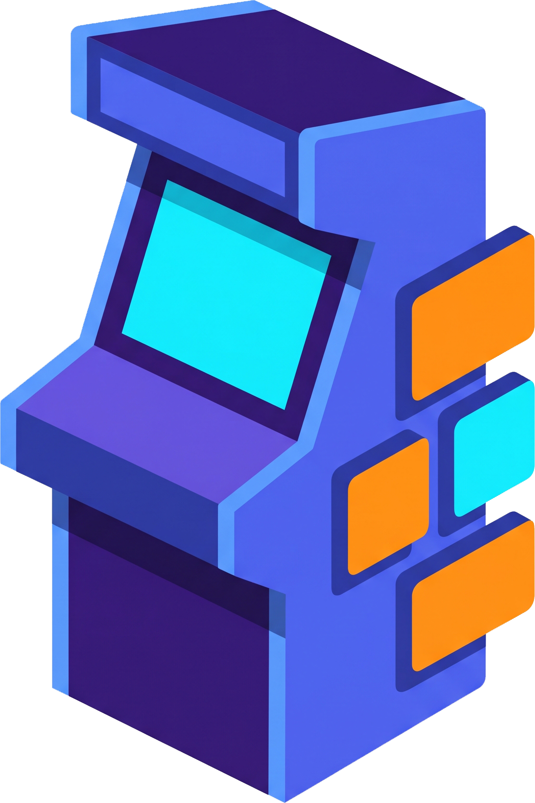
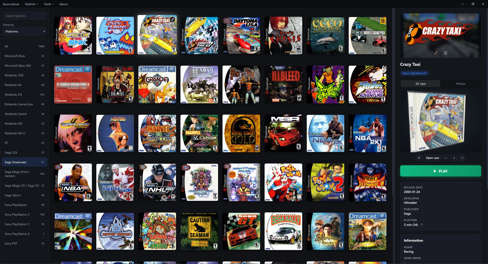
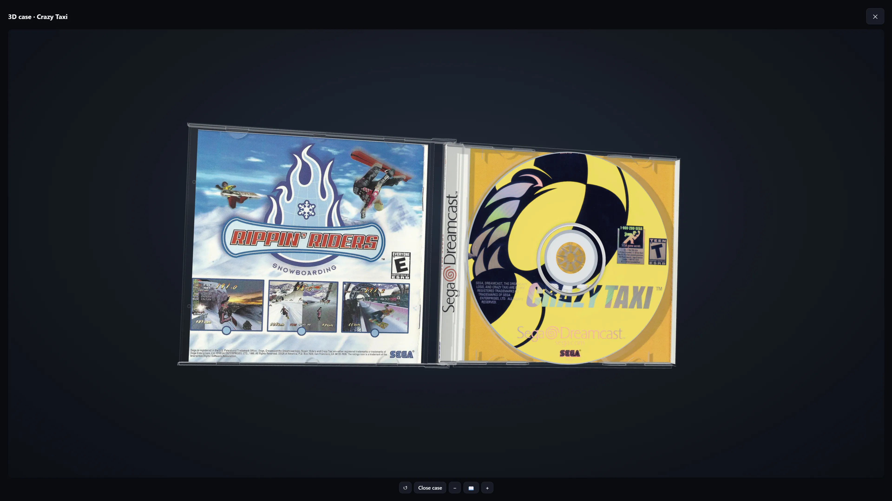
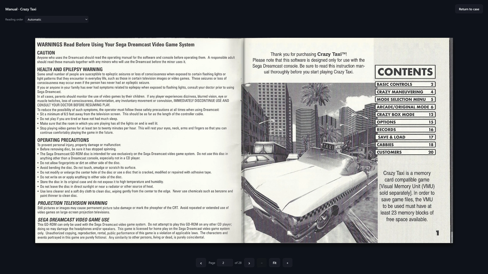
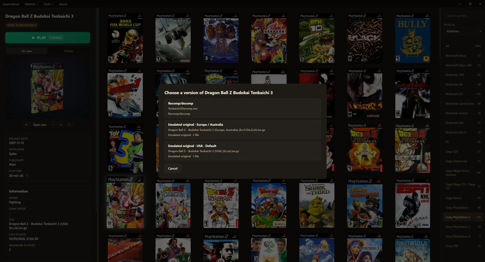

# OpenCabinet

[English](README.md) · [Español](README.es.md)



OpenCabinet is a desktop game library and launcher, built
with Tauri, Rust, SQLite and HTML/CSS/JavaScript.

Organize your games, configure emulators, download artwork and explore your
collection through interactive 3D game boxes and PDF and CBZ manuals.

[](screenshot1.webp)

<details>
<summary>View more screenshots</summary>

[](screenshot2.webp)

[](screenshot3.webp)

[](screenshot4.webp)

</details>

The project is in active development. Windows x64 builds are available in releases.
Linux x86_64 AppImage support is being validated; see the [Linux guide](docs/linux.md)
for building, testing and configuring native games, Wine and Proton/UMU.

## Features

- Import individual games, scan ROM folders and detect locally installed Steam
  and Epic Games titles (Epic Games is currently Windows-only).
- Configure emulators by platform, override launch settings per game and set up
  RetroArch with optional emulator and core downloads.
- Review detected titles, group multiple discs or regional releases and choose
  what to launch without moving or deleting the original game files.
- Browse platforms, custom categories and metadata-based groups, with search,
  multi-selection and custom ordering for game series.
- Download available game and console metadata and artwork from
  [OpenCabinet-BDD](https://github.com/Utogu9/OpenCabinet-BDD), or add local media.
- Rotate and zoom 3D boxes, open supported case models, display disc artwork and
  read locally supplied PDF and CBZ manuals page by page.
- Track play time, session counts and the last played date, including regional
  statistics and platform totals.

## Development requirements

- Windows with the [Tauri 2 prerequisites](https://v2.tauri.app/start/prerequisites/):
  Microsoft C++ Build Tools with **Desktop development with C++**, the Windows
  SDK and Microsoft Edge WebView2 Runtime.
- Linux x86_64: see the dependencies and build instructions in the [Linux guide](docs/linux.md).
- [Rust](https://www.rust-lang.org/tools/install) 1.90 or later, using the MSVC
  toolchain on Windows.
- [Node.js](https://nodejs.org/) 22.13 or later, with npm.

Download or clone this repository, then run these commands from its root:

```sh
npm ci
npm run dev
```

Dependency installation prepares the language catalogs and the local PDF.js
assets automatically. `npm run dev` starts the native Tauri application; opening
`src/index.html` directly is not a replacement for running the app.

On Windows PowerShell, use `npm.cmd` if your execution policy prevents `npm.ps1`
from running.

## First steps

1. Open **Options → Configure platforms** and **Configure emulators** to review
   your systems and launch settings. The importer can also help configure an
   emulator when a platform has none.
2. Choose **Tools → Import games**, select an import source and follow the review
   steps. Metadata and artwork downloads are optional.
3. Right-click a game to edit its details, images, manuals, discs and execution
   options. Add PDF and CBZ manuals from your own files.
4. Open **Options → Preferences** to choose the language, library appearance,
   cache settings and data location.
5. Use **About → Check for updates** to check for a new version and install it.

ROMs, PC games, BIOS files and manuals are not included. Store imports detect
installed games on this computer; they do not download your entire account
library.

## User data

By default, a `data` directory next to the executable holds the SQLite library,
managed images, manuals, metadata caches and emulator downloads.

User data and cover cache locations can be configured in Preferences. A data
location change is applied after restarting the app. A small
`opencabinet.config.json` file next to the executable records a custom location.

Back up this folder to preserve your library, media and play statistics.

## Project layout and documentation

- `src/`: interface, 3D viewers and translations.
- `src-tauri/src/`: native commands, storage, imports and process tracking.
- `tests/` and `src-tauri/tests/fixtures/`: automated tests and sample data.
- `scripts/`: preparation of translations, PDF.js and application icons.
- `docs/`: implementation details and feature documentation, currently in Spanish.

Start with [game imports](docs/importing-games.md),
[metadata and artwork](docs/metadata-sources.md),
[3D boxes and manuals](docs/game-boxes.md), [RetroArch](docs/retroarch.md),
[preferences and data](docs/preferences.md), and [translations](docs/translations.md).

## Contributing

Bug reports, translations and code contributions are welcome. For a bug, include
your operating system and version, the steps to reproduce it and the expected behavior. Use
small synthetic examples rather than uploading your library or game files.

Run the relevant tests before proposing a change. Preserve existing user data
and keep generated files, personal paths and downloaded media out of the patch.

## License and credits

Original OpenCabinet code is licensed under the [MIT License](LICENSE).

Dependencies and externally supplied media retain their respective licenses and
rights. See [third-party notices](THIRD_PARTY_NOTICES.md). OpenCabinet is an
independent project; product and platform names belong to their respective owners.
